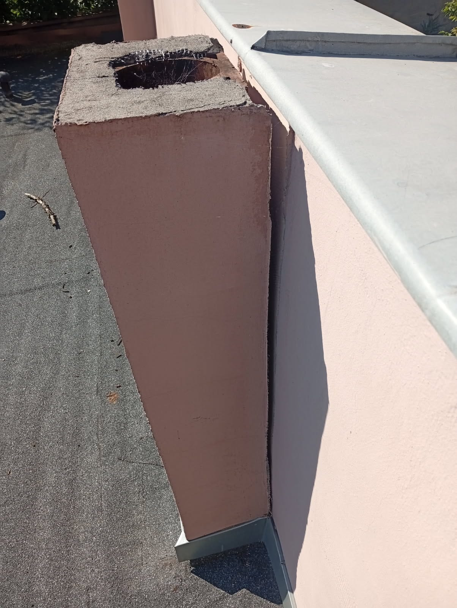
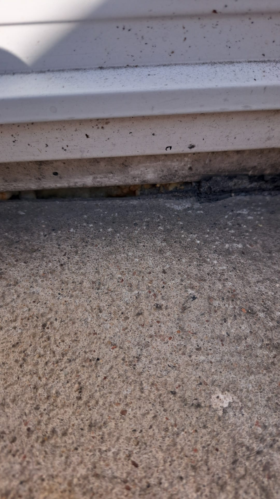
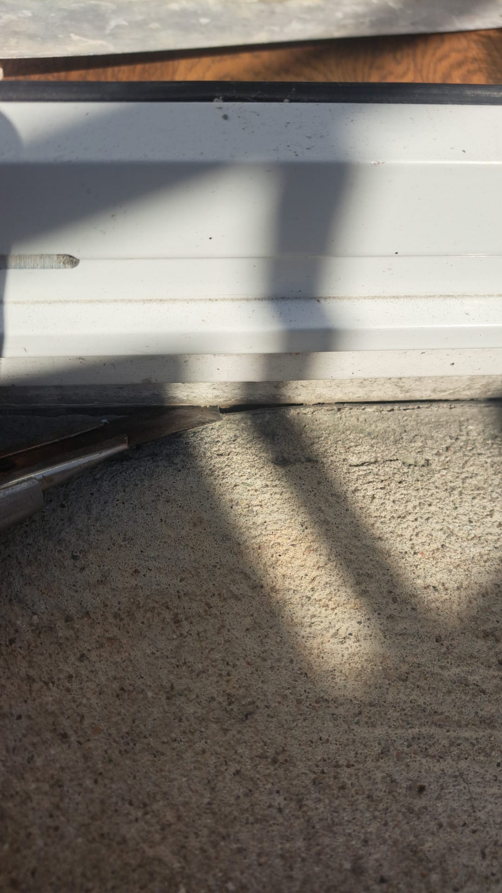
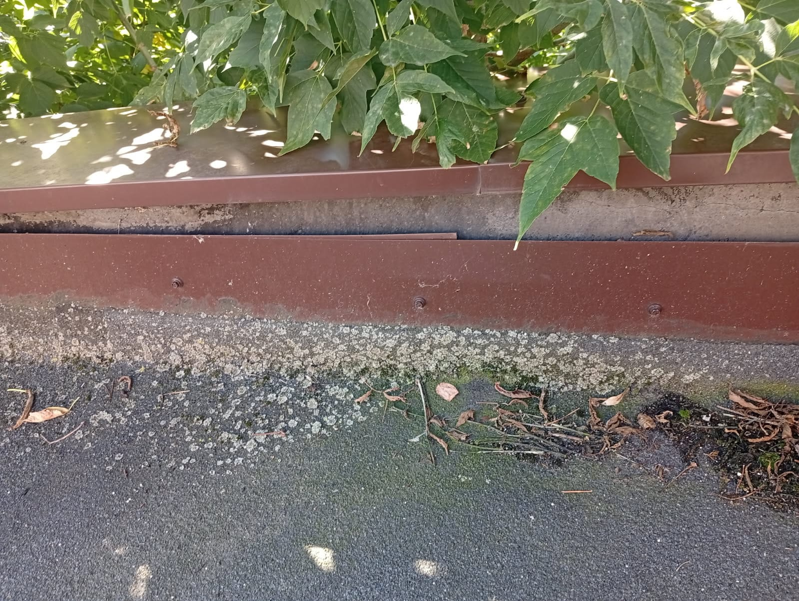
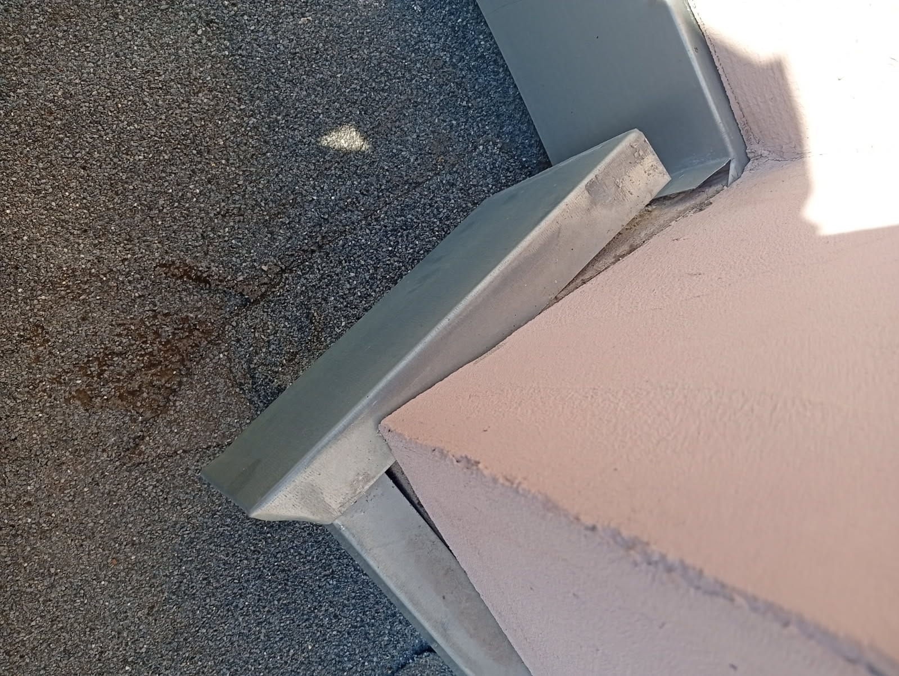

**Naprawa doraźna: odpowiedź do 9 listopada 2026 r. Remont: oferty do 30 listopada 2026 r.** Można złożyć ofertę tylko na jedną część. Jak złożyć ofertę: punkt 6.
{: .notice--info}

Wspólnota Mieszkaniowa Dąbrowskiego 96/96A w Poznaniu szuka dekarza do dachu oficyny. Potrzebujemy dwóch rzeczy:

- **naprawy doraźnej jeszcze w listopadzie 2026 r.**, żeby do wiosny dach nie przeciekał;
- **oferty na remont dachu wiosną 2027 r.** Na jej podstawie przygotujemy uchwałę właścicieli.

## 1. Dach

| | |
|---|---|
| Budynek | oficyna przy ul. Dąbrowskiego 96A, niski budynek w podwórzu, pod dachem 3 lokale mieszkalne |
| Dach | płaski, kryty papą, z attykami i kominami |
| Powierzchnia | ok. 200 m²; w ofertach z lat 2025–2026 od 174 do 225 m², do sprawdzenia na miejscu |
| Konstrukcja dachu | stan dobry według przeglądu budynku z września 2026 r. |
| Pokrycie | stan średni: miejscami odparzona papa przy attykach i kominach |
| Dokumentacja | nie mamy projektu dachu |

Przegląd budynku z września 2026 r. wskazał dwa miejsca przecieków:

- **przy kominie:** szczelina między kominem a pokryciem i zerwana obróbka blacharska; komin jest niestabilny i nieszczelny;
- **przy rynnie:** nieszczelne połączenia blachy nadrynnowej.

W dwóch lokalach pod dachem są ślady przecieków, w jednym grzyb w zabudowie szafy. Na attyce miejscami jest korozja obróbek.

Mieszkańcy wieczorami i w nocy słyszą drapanie między sufitem a dachem. Podejrzewają kunę.

  <figure>
    
    <figcaption>Attyka z ubytkiem w czapie (2025 r.)</figcaption>
  </figure>
  <figure>
    
    <figcaption>Obróbka blacharska przy krawędzi dachu (2025 r.)</figcaption>
  </figure>
  <figure>
    
    <figcaption>Pokrycie z papy (2025 r.)</figcaption>
  </figure>
  <figure>
    
    <figcaption>Styk dachu ze ścianą (2025 r.)</figcaption>
  </figure>
  <figure>
    
    <figcaption>Odwodnienie dachu (2025 r.)</figcaption>
  </figure>

## 2. Część A: naprawa doraźna, listopad 2026

Zakres według zaleceń z przeglądu budynku:

1. doklejenie papy przy attykach, kominach i przejściach przez dach, tam gdzie odstaje;
2. komin z przeciekiem: wypełnienie szczeliny i ponowny montaż albo wymiana obróbki;
3. doszczelnienie połączeń blachy nadrynnowej;
4. sprawdzenie, którędy zwierzę może wchodzić pod dach, i zabezpieczenie tych miejsc. Zwierzę nie może zostać zamknięte w środku. Jeśli trzeba je najpierw wypłoszyć, administracja wezwie firmę, która się tym zajmuje;
5. zdjęcia przed naprawą i po niej.

Jeśli Państwo to robią, prosimy też o cenę usunięcia grzyba w zabudowie szafy w jednym z lokali.

Prosimy o:

- cenę ryczałtową brutto części A;
- najbliższy termin, w którym możecie Państwo wejść na dach;
- okres gwarancji na naprawę.

## 3. Część B: remont dachu, wiosna 2027

Remont zlecimy po uchwale właścicieli. Prosimy o wycenę w dwóch wariantach:

- **B1, bez ocieplenia:** nowe pokrycie z papy termozgrzewalnej, podkładowej i wierzchniej, po naprawie podłoża;
- **B2, z ociepleniem:** jak B1, z ociepleniem dachu (np. płyty PIR albo styropapa) i paroizolacją, jeśli jest potrzebna. Grubość ocieplenia prosimy zaproponować.

W obu wariantach:

- obróbki blacharskie attyk, kominów i krawędzi dachu;
- blacha nadrynnowa, rynny i rury spustowe;
- kominki wentylacyjne; ich liczbę prosimy sprawdzić przy oględzinach;
- nakrywy i obróbki kominów;
- uszczelnienie przejść przez dach;
- wywóz odpadów.

Prosimy napisać, czy stare pokrycie zostaje, czy trzeba je zerwać, i dlaczego.

Prosimy o kosztorys z cenami jednostkowymi:

- pokrycie z papy, zł za m²;
- ocieplenie, zł za m² (wariant B2);
- obróbki blacharskie oraz rynny i rury spustowe, zł za metr;
- kominek wentylacyjny i nakrywa komina, zł za sztukę;
- razem netto i brutto dla każdego wariantu.

Do tego termin wykonania w dniach roboczych i okres gwarancji. Oczekujemy co najmniej 5 lat.

## 4. Warunki

- Prace na dachu tylko przy pogodzie, która pozwala kleić i zgrzewać papę.
- Pod dachem mieszkają ludzie. O terminie prac administracja zawiadamia mieszkańców co najmniej 7 dni wcześniej, a przy naprawie doraźnej najszybciej, jak się da.
- Płaci wspólnota, z funduszu remontowego, przelewem po odbiorze prac.
- Wykonawca ma ubezpieczenie OC.

## 5. Co ma zawierać oferta

1. dane firmy i telefon;
2. część A: cenę, najbliższy termin i gwarancję;
3. część B: kosztorys z punktu 3 dla wariantów B1 i B2, termin i gwarancję;
4. kilka zdjęć albo adresów podobnych dachów, które Państwo zrobili, jeśli to możliwe.

## 6. Jak złożyć ofertę

- **Część A:** odpowiedź do 9 listopada 2026 r.
- **Część B:** oferty do 30 listopada 2026 r.
- **E-mail:** [biuro@nieruchomoscipk.pl](mailto:biuro@nieruchomoscipk.pl), do wiadomości [zarzad@dabrowskiego96.pl](mailto:zarzad@dabrowskiego96.pl)
- **Temat:** „Oferta: dach oficyny Dąbrowskiego 96A”

Oględziny dachu umawia administracja: Nieruchomości Patrycja Kucharska, [biuro@nieruchomoscipk.pl](mailto:biuro@nieruchomoscipk.pl), tel. 507 369 487.

## 7. Wybór oferty

W części A liczą się cena i termin. W części B porównujemy cenę, zakres, gwarancję i termin. Wspólnota może wybrać dowolną ofertę, negocjować warunki albo nie wybrać żadnej.

Poprzednie zapytanie na ten dach, z 2025 r., jest [tutaj](/przetarg-remont-dachu/). Jest zakończone.

**Zarząd Wspólnoty Mieszkaniowej**  
**Dąbrowskiego 96/96A**

<link rel="stylesheet" href="/assets/css/gallery.css">

